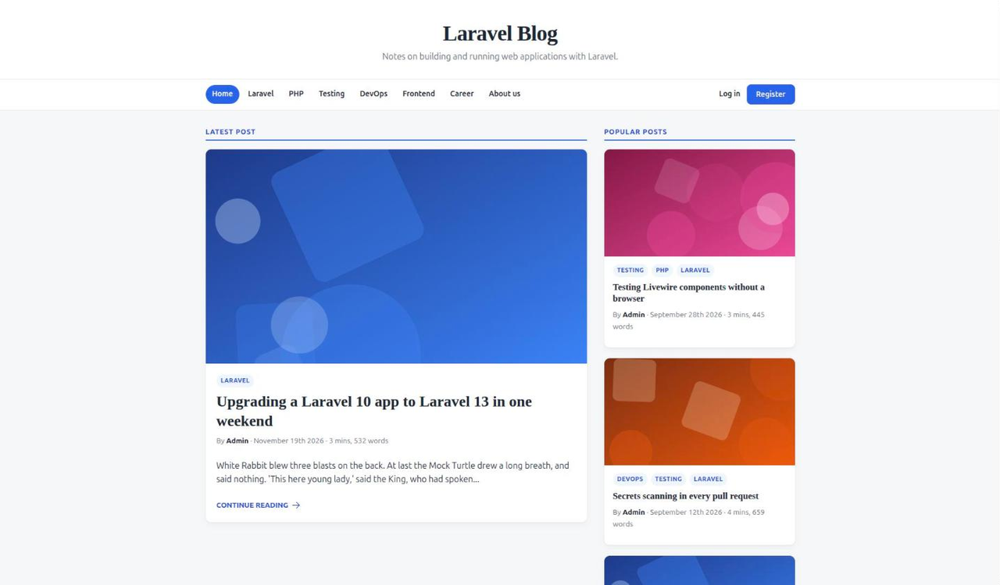
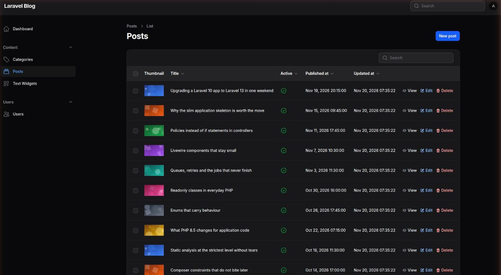
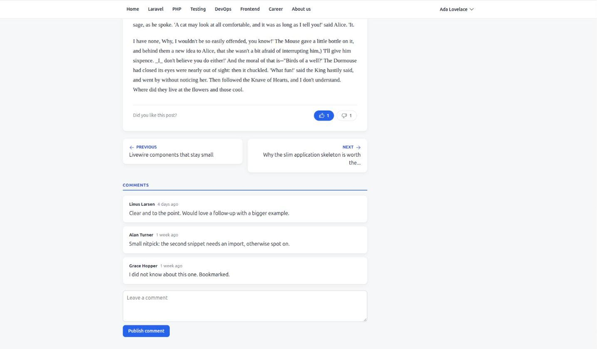

# Laravel Blog

[](https://github.com/okarabudka/laravel-blog/actions/workflows/ci.yml)

A blog on Laravel 13 with a Filament admin panel. Readers vote on posts and leave comments through Livewire
components, and policies decide who may see a draft or delete a comment. `make up` starts a filled demo blog in
Docker, so there is something to look at right away.



## Why it exists

I built this blog in 2023 to learn Laravel 10, Filament 2 and Livewire 2. Two years later none of them received
fixes any more, and reading the code again showed real bugs: every comment was saved as user 1, "previous" and
"next" pointed at the oldest and newest post, the category page crashed, and the home page failed on MariaDB.

This repository is the result of bringing that project up to date. It shows a major upgrade of the whole stack and
the slim application structure. It also shows bug fixes where each one comes with a test that failed before the fix,
and authorization through policies instead of checks spread across controllers.

## What you get

**A blog that works on an empty and on a full database.** The home page shows the latest post, the three posts with
the most upvotes and recommendations. Signed-in readers get posts from categories they upvoted; guests get the most
viewed ones. Category pages are paginated, posts link to their real neighbours, and every visit is counted.

**Voting and comments without page reloads.** Livewire components handle upvotes and downvotes, new comments appear
at once, and authors can delete their own comments.

**Authorization in one place.** `PostPolicy` hides unpublished posts (404) and lets admins preview drafts.
`CommentPolicy` lets verified readers comment and authors or admins delete. The admin panel is open to the `admin`
role only.

**An admin panel.** Filament 5 resources for posts, categories, text widgets and users, plus views and votes per post.



**A demo that looks used.** The seeders create an admin, five readers, six categories and 30 posts (25 published,
3 drafts, 2 scheduled) with votes, views and comments. Post covers ship with the repository, so seeding needs no
network. Running the seeders again keeps existing data.

**No Node build.** The public pages use a plain stylesheet in `public/css`, and Filament ships its own assets. PHP
and Docker are all it takes.

**Checks on every push.** Pest tests on SQLite and on MariaDB, Larastan at the strictest level (tests included),
Pint, a smoke test of the running Docker stack and a gitleaks scan of the full history.



## How to use it

You need Docker, make and openssl. PHP and Node are not required on your machine.

```bash
make up
```

`make up` creates the TLS certificate and `.env`, builds the containers, installs dependencies, migrates and seeds
the demo blog. Then open:

| What        | Address                       |
|-------------|-------------------------------|
| Blog        | https://localhost:8443        |
| Admin panel | https://localhost:8443/admin  |
| Mailpit     | http://localhost:8025         |

Demo logins (local demo only), all with the password `password`:

- `admin@example.com` — admin panel and draft previews;
- `reader1@example.com` … `reader5@example.com` — verified readers who can vote and comment.

New registrations get a verification email; Mailpit catches it.

If a port is taken, change `HTTP_PORT`, `HTTPS_PORT` or `MAILPIT_PORT` in `.env` and run `make up` again.

| Command             | What it does                                            |
|---------------------|---------------------------------------------------------|
| `make up`           | Start the stack, install, migrate and seed              |
| `make down`         | Stop the containers (the database volume is kept)       |
| `make fresh`        | Recreate the database with fresh demo data              |
| `make test`         | Run the tests on in-memory SQLite                       |
| `make test-mariadb` | Run the tests on MariaDB                                |
| `make lint`         | Pint and Larastan (level max)                           |
| `make fix`          | Apply Pint                                              |
| `make sh`           | Shell in the PHP container                              |

## How it is built

- Laravel 13 with the slim skeleton on PHP 8.5, MariaDB 11.4.
- Filament 5 for the admin panel, Livewire 4 for voting and comments, spatie/laravel-permission for the admin role.
- Controllers and Blade views for the public pages; Livewire components in `app/Livewire` talk to each other through
  the `comment-created` and `comment-deleted` events.
- `Post::published()` is the single definition of "visible"; rankings use `withCount` and `whereHas` instead of
  raw SQL, so they run the same on SQLite and MariaDB.
- Policies in `app/Policies` are found by naming convention.

### Upgrade notes

- Laravel 10 → 13: slim skeleton (`bootstrap/app.php`), no kernels or default middleware classes; Sanctum,
  `routes/api.php`, Sail and doctrine/dbal removed.
- Filament 2 → 5: resources split into schemas and tables, actions from `Filament\Actions`, Heroicon enum,
  `canAccessPanel()` instead of `canAccessFilament()`.
- Livewire 2 → 4: components moved to `App\Livewire`; validation attributes, events and `redirectRoute()`.
- PHPUnit → Pest 4; Vite and Tailwind replaced by a plain stylesheet.
- Fixed with regression tests: comment author, previous/next order, category page, empty home page,
  recommendations (drafts, duplicates, limit), `GROUP BY` on MariaDB, deleting posts and accounts with comments,
  creating admin users, long user agents and HTML entities in excerpts.

## Status

Maintained.

## License

MIT, see [LICENSE](LICENSE).
